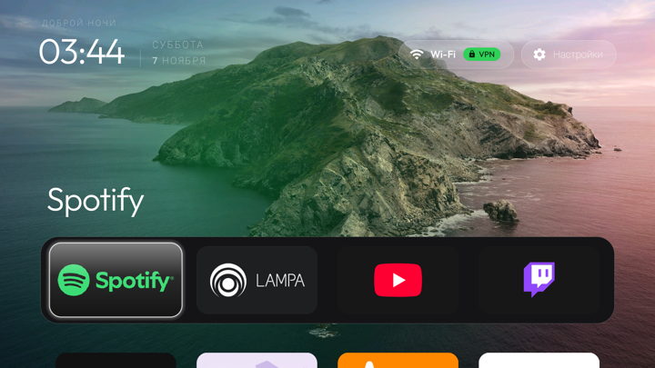
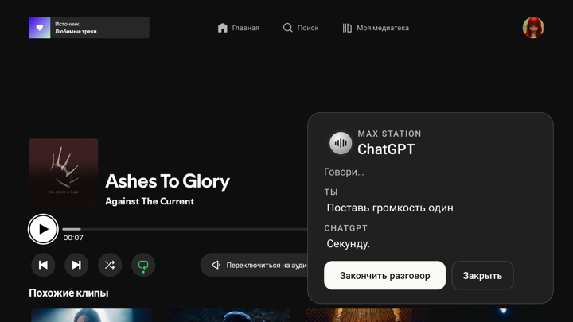

<p align="center">
  
</p>

<h1 align="center">Max Station</h1>

<p align="center">
  Станция Макс без обязательной подписки Яндекса — с ChatGPT Voice, Spotify, YouTube и Twitch.
</p>

<p align="center">
  <a href="https://github.com/svllvsxprod/max-station/releases/latest"><b>Скачать APK</b></a>
  &nbsp;·&nbsp;
  <a href="#установка"><b>Начать установку</b></a>
  &nbsp;·&nbsp;
  <a href="#команды-ассистента"><b>Посмотреть команды</b></a>
</p>

<p align="center">
  
  
  
  
</p>

<p align="center">
  <a href="#возможности">Возможности</a> ·
  <a href="#интерфейс">Интерфейс</a> ·
  <a href="#удалённые-и-сохранённые-компоненты">Пакеты</a> ·
  <a href="#интернет-и-приватность">Интернет и приватность</a>
</p>

## Цель проекта

**Цель Max Station — убрать зависимость колонки от сервисов Яндекса и пользоваться ею как обычной Bluetooth-колонкой и полноценной Android TV-приставкой.** Для музыки, видео и голосового управления установлены другие приложения. Аккаунт и подписка Яндекса для этих функций больше не нужны.

**Облачным сервисам Яндекса закрыт выход в интернет.** Из основного пользователя Android удалены 22 пакета, в том числе Алиса, Яндекс Музыка, штатный главный экран, магазин, обновлятор и мастер настройки. Шесть пакетов оставлены для кнопок, звука, индикации, пульта и настроек. Они работают локально под сетевыми ограничениями. Запрет проверен после загрузки Android. Что происходит до запуска защиты, описано в разделе [об интернете и приватности](#интернет-и-приватность).

| Для чего | Что теперь используется |
| --- | --- |
| Голосовой помощник вместо Алисы | **ChatGPT Voice** через приложение Max Station Voice и OpenAI API. Он отвечает на вопросы и управляет колонкой — ставит будильники, открывает приложения, включает музыку, переключает треки и меняет громкость. |
| Музыка вместо Яндекс Музыки | **Spotify** для Android TV, включая личные «Любимые треки». |
| Видео | **YouTube** через TizenTube Cobalt. |
| Прямые трансляции | **Twitch** через SmartTV Client for Twitch. |
| Фильмы, сериалы и просмотр торрентов | **Lampa**, торрент-сервер **TorrServer** и видеоплеер. В этой конфигурации сервер отдельный, а колонка воспроизводит переданное им видео. |
| Главный экран | **CleanYourTV** с нужными приложениями и ярлыками настроек. |
| Видеофайлы и сетевые потоки | **VLC**. |

Ассистент запускается прямо на колонке. Удержание кнопки на пульте открывает голосовую панель поверх текущего приложения и сопровождается звуковым сигналом. Можно пользоваться им с выключенным телевизором. Исходники приложения открыты, поэтому при желании можно подключить другого голосового помощника. Для этого потребуется доработать интеграцию с выбранным сервисом.

Для просмотра торрентов Lampa обращается к TorrServer, а плеер получает от него видеопоток. В этой конфигурации используется отдельный удалённый сервер. У TorrServer есть Android-версия, так что можно отдельно попробовать разместить его на колонке. Локальная установка и её производительность на Max пока не проверены. [Проект TorrServer](https://github.com/YouROK/TorrServer).

Проект рассчитан на **Станцию Макс первого поколения YNDX-0008 без Zigbee**, с **Android 9 и сборкой 5000000921**. Подготовка и проверки выполнены на одной колонке. Пульт, микрофоны, колесо громкости, передний дисплей и подсветка кольца продолжают работать.

## Возможности

- **Bluetooth.** Четыре коротких нажатия кнопки отключения микрофонов включают режим подключения. Колонка показывает значок Bluetooth и включает синюю подсветку. Громкость меняется с телефона и колесом на корпусе.
- **ТВ-приставка.** Spotify для музыки, YouTube для видео, Twitch для трансляций, Lampa для фильмов и сериалов, VLC для видеофайлов и потоков. CleanYourTV собирает их на одном главном экране.
- **Ассистент на пульте.** Удерживайте кнопку около секунды и отпустите. Панель появляется поверх открытого приложения. Короткий сигнал слышен и при выключенном телевизоре.
- **Будильники и музыка без экрана.** Голосом можно остановить звонящий будильник, включить свои «Любимые треки» в Spotify, переключить песню и поменять громкость.
- **Два способа голосового ввода.** Разговор с ассистентом идёт через OpenAI API. Groq можно отдельно подключить для диктовки в приложениях, которые пользуются системным распознавателем Android.

## Интерфейс

<table align="center">
  <tr>
    <td align="center" colspan="2"><br><sub>Главный экран CleanYourTV с приложениями и выбранными обоями</sub></td>
  </tr>
  <tr>
    <td align="center" width="50%"></td>
    <td align="center" width="50%"></td>
  </tr>
  <tr>
    <td align="center"><sub>Голосовой ассистент</sub></td>
    <td align="center"><sub>Выбор времени будильника</sub></td>
  </tr>
  <tr>
    <td align="center" colspan="2"><br><sub>Экран во время звонка</sub></td>
  </tr>
  <tr>
    <td align="center" colspan="2"><br><sub>Плавающий ассистент поверх Spotify</sub></td>
  </tr>
</table>

Удержание кнопки ассистента на пульте вызывает компактную панель поверх текущего приложения. На снимке — управление громкостью из Spotify, без перехода на главный экран ассистента.

Снимки сделаны на колонке. Личный баланс на экране ассистента скрыт.

## Установка

1. **Проверьте модель.** Найдите маркировку YNDX-0008 на корпусе. Подключите питание и HDMI. Для первых шагов подготовьте отдельную сеть без выхода в интернет, чтобы колонка не получила штатное обновление.
2. **Соберите USB-кабель.** На плате, если смотреть как на фото автора, контакты идут от AUX к гнезду питания. Для ADB нужны только контакты 1–3. Прозвоните жилы перед пайкой, потому что цвета в кабеле могут отличаться. Линию USB +5 В изолируйте. Колонка питается от своего блока. [Распиновка и фото разъёма](docs/usb.md).
3. **Подготовьте прошивку и доступ.** На проверенной колонке использовалась AliceBridge 1.0.21 с профилем Max первого поколения. После установки на самой колонке подтверждена сборка **5000000921**. Затем проверен доступ ADB и запущен готовый root-bridge с компьютера. [Первичная настройка](docs/setup.md) · [Команды для получения и проверки root](docs/root.md).
4. **Замените главный экран.** Поставьте CleanYourTV и клавиатуру для ТВ, затем проверьте пульт и оба меню настроек. После этого убирайте штатные приложения небольшими группами. Проверьте, что обновлятор и мастер настройки удалены для основного пользователя Android.
5. **Установите APK и настройте сеть.** Сверьте контрольные суммы, установите Max Station Voice и ярлыки настроек. Настройте белый список и проверьте запрет соединений до подключения колонки к интернету.
6. **Настройте голос и проверьте результат.** Введите собственный ключ OpenAI в локальной форме, проверьте разговор и микрофон пульта. Для голосового запуска «Любимых треков» войдите в Spotify и разрешите Max Station Voice управление его окном через специальные возможности Android. Проверьте запуск музыки с выключенным телевизором.

<p align="center"></p>

| Сервисная колодка | Сигнал | USB-A компьютера |
| --- | --- | --- |
| 1 | D+ | 3 |
| 2 | D− | 2 |
| 3 | Земля | 4 |

В [релизе](https://github.com/svllvsxprod/max-station/releases/latest) лежат `max-station-voice.apk`, `max-station-settings.apk` и диагностический `max-station-local-backend.apk`. Для работы ассистента достаточно первого. Второй добавляет ярлыки, третий нужен только для отдельных проверок.

```sh
shasum -a 256 -c SHA256SUMS.txt
adb install max-station-settings.apk
adb install max-station-voice.apk
adb shell am start -n org.yanalice.voice/.AssistantHome
```

## Удалённые и сохранённые компоненты

| Изменение | Результат |
| --- | --- |
| Настройка, подписка и обновления | Для основного пользователя Android удалены мастер настройки, обновлятор и службы, участвовавшие во входе и проверке подписки. У Platform Services сняты права владельца устройства. Аккаунт Яндекса удалён. |
| Штатные приложения | Всего удалено 22 пакета. Среди них Алиса, прежний главный экран, магазин, оплаты, реклама, отчёты, музыка, эфир и плееры. |
| Кнопки, пульт и индикация | Сохранены IoSDK и служба BLE-пульта. При пробной замене IoSDK музыка играла, но часть индикации и регулировка громкости работали с ошибками. |
| Настройки и системные компоненты | Сохранены настройки HDMI и звука, привилегированные ТВ-службы, системное расширение и пакет конфигурации устройства. |

Штатные APK по-прежнему лежат в защищённых разделах. Android может показать их при выводе списка удалённых пакетов. После заводского сброса состав приложений нужно проверять заново. [Все 28 идентификаторов пакетов и команды проверки](docs/packages.md).

## Команды ассистента

| Приложение | Пример команды | Что получится |
| --- | --- | --- |
| Max Station Voice | «Поставь будильник через минуту», «Выключи будильник» | Будильник зазвонит, а команда остановит звонок. |
| Max Station Voice | «Запомни, как меня зовут», «Запомни город для погоды», «Говори о себе в женском роде» | Настройки сохранятся для следующих разговоров. |
| Spotify для Android TV | «Включи любимые треки», «Открой альбом Meteora в Spotify» | Запустится личная коллекция или откроется альбом. Запуск коллекции проверен с выключенным телевизором. |
| Активный плеер Android | «Выключи музыку», «Следующий трек», «Предыдущий трек» | Пауза или переключение трека. Проверено в Spotify. |
| Системная громкость | «Громкость 7» | Колонка выставит уровень 7 из 10. |
| TizenTube Cobalt | «Найди … на YouTube», «Открой видео …» | Откроются результаты поиска или конкретное видео. |
| SmartTV Client for Twitch | «Открой Twitch» | Откроется клиент Twitch. Открытие конкретного стрима по имени пока не работает. |
| Lampa TV | «Найди Интерстеллар в Лампе» | Команда передаёт ссылку на карточку. Открытие карточек проверено, голосовой запуск фильма ещё предстоит проверить. |
| VLC для Android | «Открой VLC» | Команда открывает приложение. Отдельный голосовой тест пока не проведён. |

[Все команды, настройки личной медиатеки и результаты проверок](docs/commands.md).

## Интернет и приватность

После загрузки Android Rethink закрывает сетевой доступ приложениям по умолчанию. Нужные приложения добавляются в белый список вручную. В проверенной конфигурации правила IPv4 и IPv6 также ограничивают прямой выход нескольких системных служб. Для доступа через внешний VPN подключайте колонку к **роутеру с работающим VPN**. На самой колонке VPN-интерфейс Android используется для локальной фильтрации.

Запрет проверен после загрузки и при остановке фильтра. Отдельная проверка трафика с момента подачи питания до запуска защиты на Wi-Fi и Ethernet ещё нужна. [Сетевая схема и команды проверки](docs/network.md).

Ключи OpenAI и Groq каждый владелец вводит сам. Они сохраняются на колонке через Android Keystore. Для обычного разговора компьютер или отдельный голосовой сервер не нужны.

## Использованные проекты

| Проект | Для чего |
| --- | --- |
| [AliceBridge 1.0.21](https://github.com/Yandex-Station-Universal-Repo/AliceBridge_APP/releases/tag/v1.0.21) | Первичная настройка, установка нужной прошивки и готовые инструменты для временного root. |
| [Схема mamaich](https://dzen.ru/a/Zy6EXfvg1T664f7W) | Назначение контактов сервисного разъёма и фото платы с нумерацией. |
| [CleanYourTV](https://cleanyour.tv/) и [LeanKeyKeyboard](https://github.com/yuliskov/LeanKeyboard) | Главный экран и клавиатура для пульта. |
| [Rethink](https://github.com/celzero/rethink-app) | Локальный сетевой фильтр. |
| [Spotify для Android TV](https://connect.spotify.com/devices/android-tv), [TizenTube Cobalt](https://github.com/reisxd/TizenTubeCobalt), [SmartTV Client for Twitch](https://github.com/fgl27/SmartTwitchTV), [Lampa TV](https://github.com/lampa-app/LAMPA) и [VLC](https://www.videolan.org/vlc/download-android.html) | Клиенты, которые ставятся отдельно. |

## Исходники и подробные инструкции

| Где искать | Что там |
| --- | --- |
| [voice-input](voice-input/) | Голосовой ассистент, распознавание речи, будильники и управление Spotify |
| [settings-shortcuts](settings-shortcuts/) | Ярлыки для настроек Android и приложений |
| [remote](remote/) | Обработчик долгого нажатия на пульте |
| [local-backend](local-backend/) | Диагностическая служба |
| [Сборка APK](docs/build.md) | Инструменты, подпись и проверка файлов |
| [Инструкция для агента](docs/agent.md) | Задание, с которым можно повторить настройку и проверить результат |

Исходный код проекта опубликован под [PolyForm Noncommercial](LICENSE). У сторонних зависимостей [свои лицензии](third-party/DEPENDENCIES.md).
