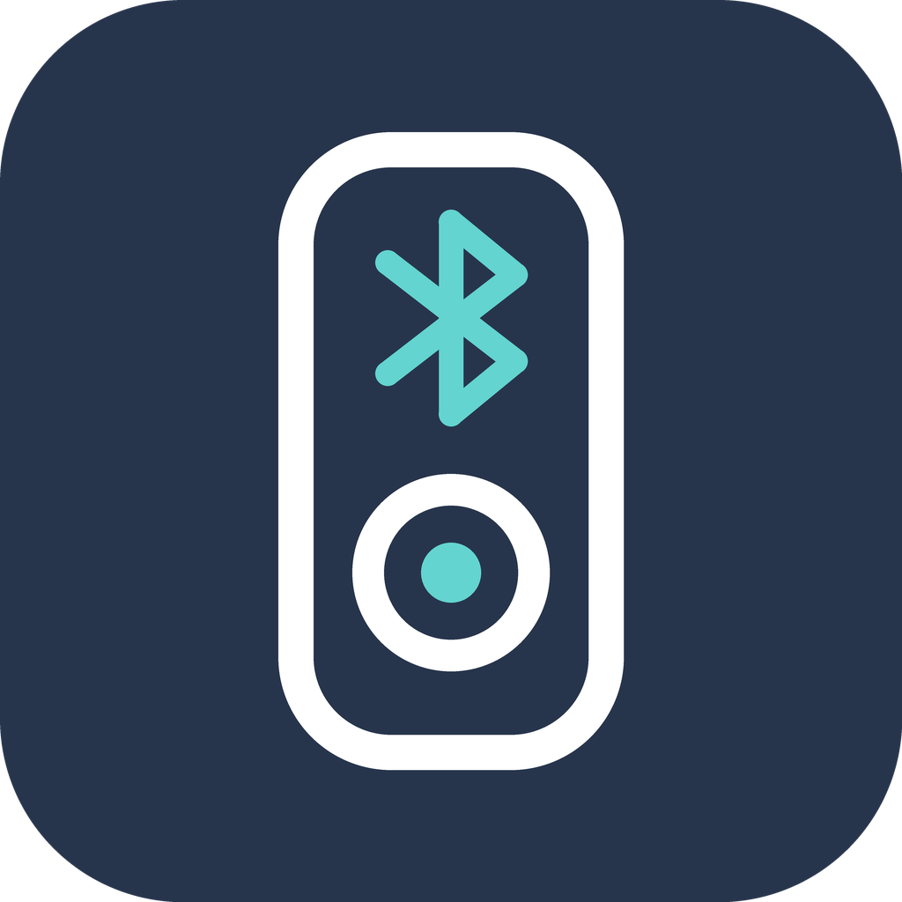
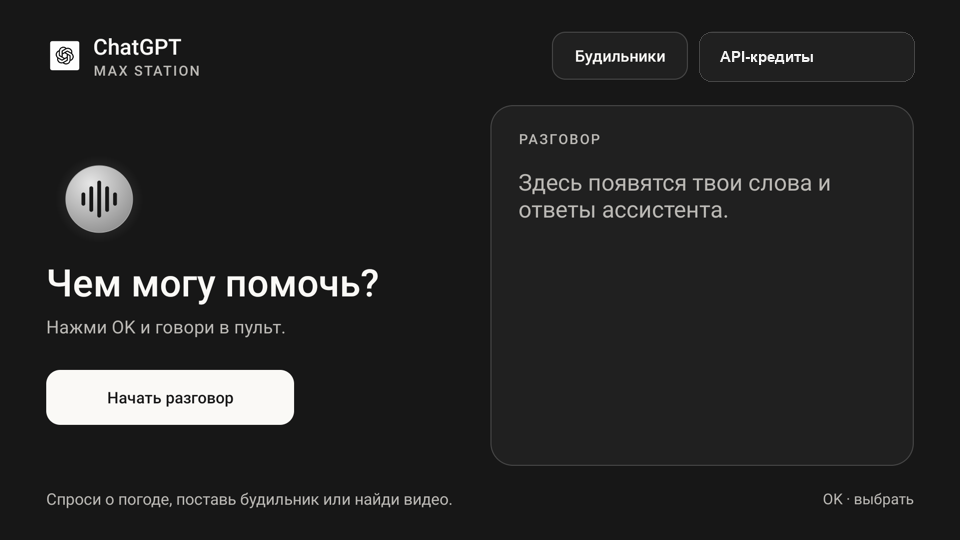
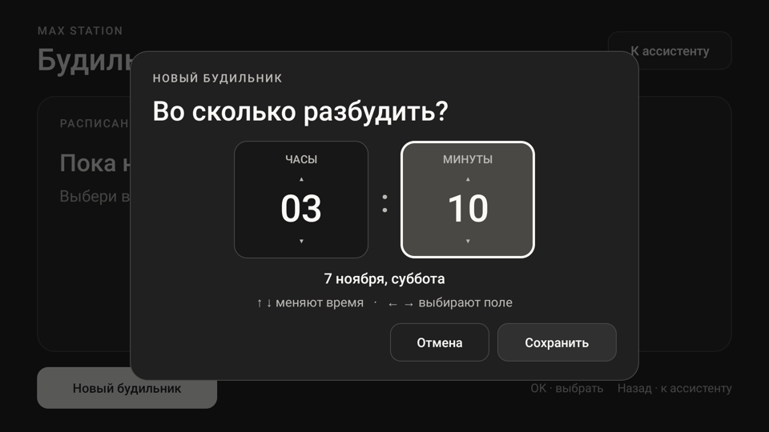
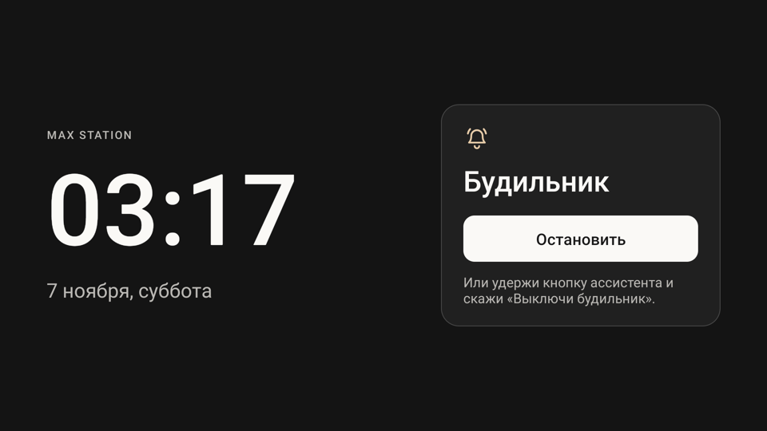
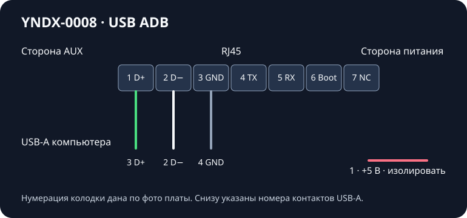

<p align="center">
  
</p>

<h1 align="center">Max Station</h1>

<p align="center">
  Bluetooth-колонка и ТВ-приставка из Яндекс Станции Макс первого поколения.
</p>

<p align="center">
  <a href="https://github.com/svllvsxprod/max-station/releases/latest"><b>Скачать APK</b></a>
  &nbsp;·&nbsp;
  <a href="#установка"><b>Начать установку</b></a>
  &nbsp;·&nbsp;
  <a href="#команды-ассистента"><b>Посмотреть команды</b></a>
</p>

<p align="center">
  
  
  
  
</p>

<p align="center">
  <a href="#возможности">Возможности</a> ·
  <a href="#интерфейс">Интерфейс</a> ·
  <a href="#что-удалили-и-что-оставили">Пакеты</a> ·
  <a href="#интернет-и-приватность">Интернет и приватность</a>
</p>

## О проекте

Max Station — переделка Станции Макс **YNDX-0008 без Zigbee**. После настройки колонка воспроизводит музыку по Bluetooth и работает как ТВ-приставка без аккаунта и подписки Яндекса. Вместо штатного главного экрана используется CleanYourTV, а голосовой помощник запускается прямо на колонке. Пульт, микрофоны, колесо громкости, передний дисплей и подсветка кольца остались в деле.

Весь этот набор проверили на одной колонке с **Android 9, сборка 5000000921**. Начальная настройка требует телефона, компьютера и самодельного USB-кабеля. APK нужны на более позднем этапе, когда на колонке уже работает ADB.

## Возможности

- **Bluetooth.** Четыре коротких нажатия кнопки отключения микрофонов включают режим подключения. Колонка показывает значок Bluetooth и включает синюю подсветку. Громкость меняется с телефона и колесом на корпусе.
- **ТВ-приставка.** CleanYourTV, отдельные ярлыки настроек Android и приложения Spotify, TizenTube, Twitch, Lampa и VLC.
- **Ассистент на пульте.** Удерживайте кнопку около секунды и отпустите. Панель появляется поверх открытого приложения. Короткий сигнал слышен и при выключенном телевизоре.
- **Будильники и музыка без экрана.** Голосом можно остановить звонящий будильник, включить свои «Любимые треки» в Spotify, переключить песню и поменять громкость.
- **Два способа голосового ввода.** Разговор с ассистентом идёт через OpenAI API. Groq можно отдельно подключить для диктовки в приложениях, которые пользуются системным распознавателем Android.

## Интерфейс

<table align="center">
  <tr>
    <td align="center" width="50%"></td>
    <td align="center" width="50%"></td>
  </tr>
  <tr>
    <td align="center"><sub>Голосовой ассистент</sub></td>
    <td align="center"><sub>Выбор времени будильника</sub></td>
  </tr>
  <tr>
    <td align="center" colspan="2"><br><sub>Экран во время звонка</sub></td>
  </tr>
</table>

Снимки сделаны на колонке. Личный баланс на экране ассистента скрыт.

## Установка

1. **Проверьте модель.** Найдите маркировку YNDX-0008 на корпусе. Подключите питание и HDMI. Для первых шагов подготовьте отдельную сеть без выхода в интернет, чтобы колонка не получила штатное обновление.
2. **Соберите USB-кабель.** На плате, если смотреть как на фото автора, контакты идут от AUX к гнезду питания. Для ADB нужны только контакты 1–3. Прозвоните жилы перед пайкой, потому что цвета в кабеле могут отличаться. Красный провод подключать по цвету нельзя. Линию USB +5 В изолируйте, колонка питается от своего блока. [Распиновка и фото разъёма](docs/usb.md).
3. **Подготовьте прошивку и доступ.** На проверенной колонке использовали AliceBridge 1.0.21 с профилем Max первого поколения. После установки сверили сборку **5000000921** на самой колонке. Затем проверили доступ командой `adb devices -l` и получили временные права через готовый совместимый метод AliceBridge. [Порядок действий и что проверить, если мастер не пускает в меню](docs/setup.md).
4. **Замените главный экран.** Поставьте CleanYourTV и клавиатуру для ТВ, затем проверьте пульт и оба меню настроек. После этого убирайте штатные приложения небольшими группами. Проверьте, что обновлятор и мастер настройки удалены для основного пользователя Android.
5. **Установите APK и настройте сеть.** Сверьте контрольные суммы, установите Max Station Voice и ярлыки настроек. Настройте белый список и проверьте запрет соединений до подключения колонки к интернету.
6. **Настройте голос и проверьте результат.** Введите собственный ключ OpenAI в локальной форме, проверьте разговор и микрофон пульта. Для голосового запуска «Любимых треков» войдите в Spotify и разрешите Max Station Voice управление его окном через специальные возможности Android. Проверьте запуск музыки с выключенным телевизором.

<p align="center"></p>

| Сервисная колодка | Сигнал | USB-A компьютера |
| --- | --- | --- |
| 1 | D+ | 3 |
| 2 | D− | 2 |
| 3 | Земля | 4 |

В [релизе](https://github.com/svllvsxprod/max-station/releases/latest) лежат `max-station-voice.apk`, `max-station-settings.apk` и диагностический `max-station-local-backend.apk`. Для работы ассистента достаточно первого. Второй добавляет ярлыки, третий нужен только для отдельных проверок.

```sh
shasum -a 256 -c SHA256SUMS.txt
adb install max-station-settings.apk
adb install max-station-voice.apk
adb shell am start -n org.yanalice.voice/.AssistantHome
```

## Что удалили и что оставили

| Изменение | Что сделали |
| --- | --- |
| Настройка, подписка и обновления | Убрали для основного пользователя Android мастер настройки, обновлятор и службы, участвовавшие во входе и проверке подписки. Сняли права владельца устройства у Platform Services и убрали аккаунт Яндекса. |
| Штатные приложения | Всего удалили 22 пакета. Среди них Алиса, прежний главный экран, магазин, оплаты, реклама, отчёты, музыка, эфир и плееры. |
| Кнопки, пульт и индикация | Оставили IoSDK и службу BLE-пульта. При пробной замене IoSDK музыка играла, но часть индикации и регулировка громкости работали с ошибками. |
| Настройки и системные компоненты | Сохранили настройки HDMI и звука, привилегированные ТВ-службы, системное расширение и пакет конфигурации устройства. |

Штатные APK по-прежнему лежат в защищённых разделах. Android может показать их при выводе списка удалённых пакетов. После заводского сброса состав приложений нужно проверять заново. [Все 28 идентификаторов пакетов и команды проверки](docs/packages.md).

## Команды ассистента

| Что сказать | Что проверили |
| --- | --- |
| «Поставь будильник через минуту», «Выключи будильник» | Будильник зазвонил, голосовая команда остановила звонок. |
| «Включи любимые треки в Spotify» | Запустилась личная коллекция при выключенном телевизоре. |
| «Выключи музыку», «Следующий трек», «Предыдущий трек», «Громкость 7» | Пауза, переключение в обе стороны и установка громкости по шкале 0–10. |
| «Открой альбом Meteora в Spotify», «Найди видео на YouTube» | Открывались нужный альбом, видео или результаты поиска в TizenTube. |
| «Запомни, как меня зовут», «Запомни город для погоды», «Говори о себе в женском роде» | Ассистент вспомнил все три настройки после повторного вызова панели. |

Twitch открывается голосом, а текст в поиск можно продиктовать через клавиатуру. Открытие конкретного стрима по имени пока не работает. В Lampa проверены ссылки на карточки фильмов и сериалов. [Подробный список команд и результаты проверок](docs/commands.md).

## Интернет и приватность

После загрузки Android Rethink закрывает сетевой доступ приложениям по умолчанию. Нужные приложения добавляются в белый список вручную. В проверенной конфигурации правила IPv4 и IPv6 также ограничивают прямой выход нескольких системных служб. Для доступа через внешний VPN подключайте колонку к **роутеру с работающим VPN**. На самой колонке VPN-интерфейс Android используется для локальной фильтрации.

Проверили запрет после загрузки и при остановке фильтра. Отдельная проверка трафика с момента подачи питания до запуска защиты на Wi-Fi и Ethernet ещё нужна. [Сетевая схема и команды проверки](docs/network.md).

Ключи OpenAI и Groq каждый владелец вводит сам. Они сохраняются на колонке через Android Keystore. Для обычного разговора компьютер или отдельный голосовой сервер не нужны.

## Исходники и подробные инструкции

| Где искать | Что там |
| --- | --- |
| [voice-input](voice-input/) | Голосовой ассистент, распознавание речи, будильники и управление Spotify |
| [settings-shortcuts](settings-shortcuts/) | Ярлыки для настроек Android и приложений |
| [remote](remote/) | Обработчик долгого нажатия на пульте |
| [local-backend](local-backend/) | Диагностическая служба |
| [Сборка APK](docs/build.md) | Инструменты, подпись и проверка файлов |
| [Инструкция для агента](docs/agent.md) | Задание, с которым можно повторить настройку и проверить результат |

Исходный код проекта опубликован под [PolyForm Noncommercial](LICENSE). У сторонних зависимостей [свои лицензии](third-party/DEPENDENCIES.md).
