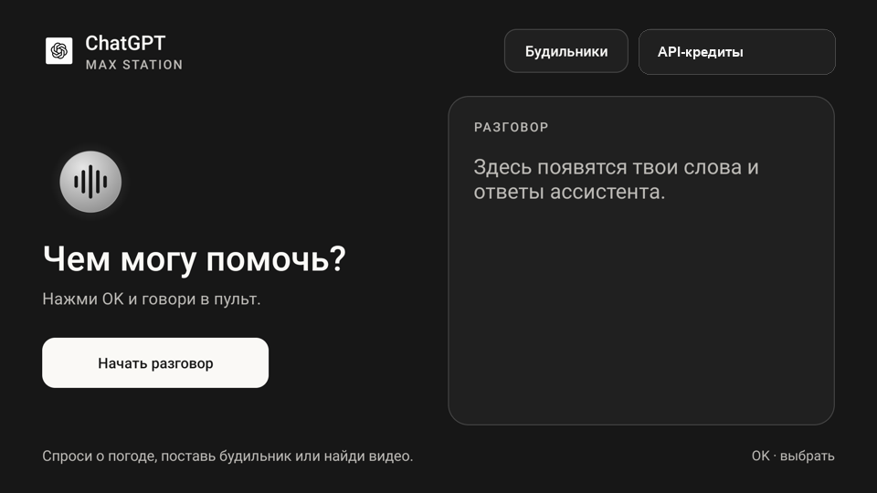
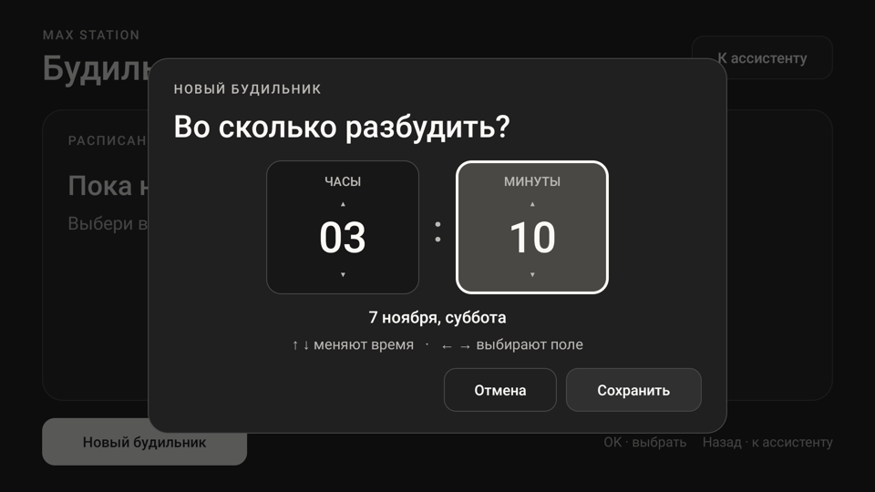

# Max Station

**Bluetooth-колонка и Android TV на базе Яндекс Станции Макс первого поколения**

[English](README.md) · [Руководство с нуля](docs/setup.md) · [Скачать APK](https://github.com/svllvsxprod/max-station/releases)

Проект описывает переделку **YNDX-0008 без Zigbee** на Android 9, сборка **5000000921**. На проверенной колонке штатный аккаунт Яндекса и подписка больше не нужны для Bluetooth, пульта и ТВ-интерфейса. Мастер настройки, активный обновлятор и службы, участвовавшие в штатном входе и проверках подписки, удалены для пользователя Android. Для кнопок, микрофонов, звука, переднего дисплея и кольца сохранены нужные штатные компоненты.

  
  

- **Без телевизора.** Долгое нажатие кнопки ассистента на пульте вызывает голосовую панель со звуковым сигналом. Проверены выключение звонящего будильника и запуск своих «Любимых треков» Spotify при выключенном телевизоре.
- **Как ТВ-приставка.** CleanYourTV, отдельные ярлыки настроек Android, Spotify, TizenTube, Twitch, Lampa и VLC. Голосовые команды зависят от возможностей конкретного клиента.
- **Интернет по белому списку.** После загрузки штатный доступ приложений, включая системные, закрыт по умолчанию. Для выхода через VPN колонка подключается к роутеру с рабочим туннелем. Раннее окно при загрузке описано отдельно.

[Установка с нуля](docs/setup.md) · [Схема кабеля](docs/usb.md) · [Что удалили и что оставили](docs/packages.md) · [Сетевая защита](docs/network.md) · [Команды и проверка](docs/commands.md) · [Как передать работу агенту](docs/agent.md) · [Сборка и APK](docs/build.md)

Скриншоты сделаны на рабочем экземпляре. Баланс на снимке закрыт. [Экран звонящего будильника](docs/images/alarm-ringing.png).
