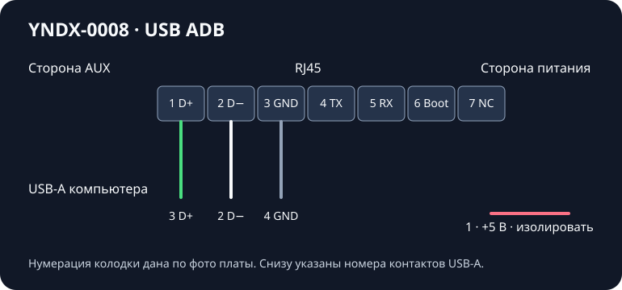

# Кабель USB для Android ADB

Эта распиновка относится к YNDX-0008 первого поколения без Zigbee. Сервисная колодка с семью контактами под нижней резиновой накладкой. На фотографии платы автора номера идут от **AUX к гнезду питания**, вдоль RJ45. При осмотре снизу или со стороны пайки проверьте ориентацию по разъёмам и подписанному фото перед соединением. [Статья mamaich](https://dzen.ru/a/Zy6EXfvg1T664f7W) · [Фото с нумерацией](https://avatars.dzeninfra.ru/get-zen_doc/271828/pub_672e845dfbe0d53ebae1fed6_672e867d195f146050cc989d/orig).

| Контакт колонки | Сигнал | Контакт USB-A на стороне компьютера | Обычный цвет |
| --- | --- | --- | --- |
| 1 | D+ | 3 | Зелёный |
| 2 | D− | 2 | Белый |
| 3 | GND | 4 | Чёрный, в одном из проверенных кабелей серый |
| 4 | UART TX | Оставить свободным | |
| 5 | UART RX | Оставить свободным | |
| 6 | Выбор USB Boot | Оставить свободным | |
| 7 | Не подключён по схеме автора | Оставить свободным | |
| — | VBUS +5 В | 1, изолировать отдельно | Красный |

1. Возьмите исправный кабель USB-A с передачей данных. Оставьте штекер для компьютера, второй конец отрежьте. Прозвоните каждую жилу от контакта USB-A. Цвет и голый экран кабеля сами по себе не определяют землю. [USB 2.0, спецификация USB-IF](https://www.usb.org/document-library/usb-20-specification).
2. Подберите три изолированных вставных контакта под колодку. В опыте использовался самодельный паяный кабель, при сборке подбирались контакты из старого разъёма. Для повторения подойдут подпружиненные щупы в жёсткой оправке или извлечённые контакты, если по размеру держатся без усилия. Проверенный типоразмер штырька для заказа отсутствует. Сохраните пару D+/D− короткой и скрученной почти до контактов, изолируйте каждый штырёк и закрепите кабель от натяжения.
3. При отсоединённых USB и питании вставьте контакты 1–3. Проверьте, что D+, D− и GND прозваниваются только до своих контактов. Изолируйте USB +5 В. Колонка питается своим блоком.
4. Подключите USB к компьютеру и запустите колонку обычным способом. При работающем и разрешённом ADB появится статус `device` в `adb devices -l`. При `unauthorized` подтвердите ключ на телевизоре. При пустом списке проверьте сначала обнаружение USB в ОС, потом соединения и доступность отладки на прошивке. USB-устройство в ОС ещё не гарантирует наличие ADB.

Этот кабель подтвердил рабочий Android ADB на одном YNDX-0008. Отдельно наблюдалось обнаружение сервисного USB загрузчика. Доступ на запись в него и восстановление не подтверждены. Для обычной установки из этого руководства контакт №6 оставляют свободным.
